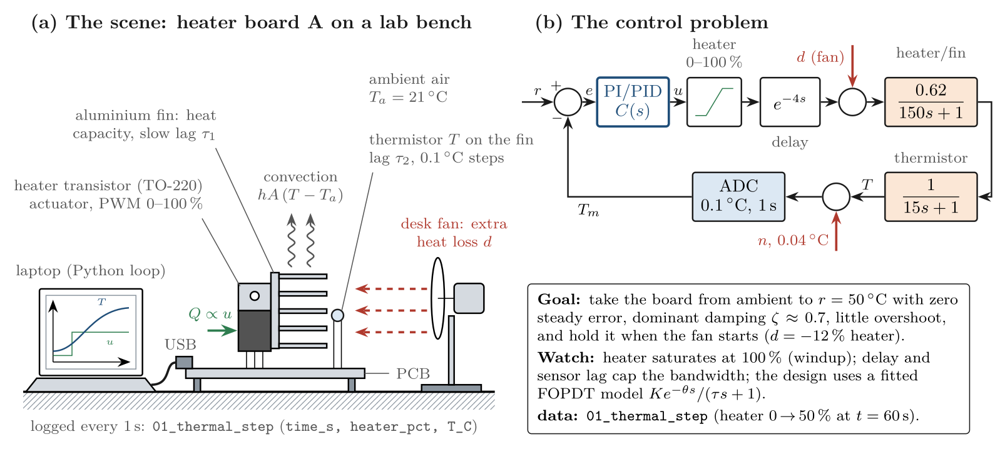

# Lab 01: temperature control of a heater-and-sensor board

A transistor heats a small aluminium fin and a thermistor measures its temperature, in the style of the open
TCLab kit. We log a heater step, identify a first-order-plus-dead-time (FOPDT) model, see why proportional
control leaves an error, design a PI/PID controller on the root locus, run it with a saturating heater (and
show windup), and use Bode and Nyquist plots to see how the dead time caps the phase margin and bandwidth.



## System and parameters

| quantity | demo board A | homework board B | basis |
|---|---|---|---|
| heater input | 0-100 % (PWM of the transistor) | same | TCLab-style firmware |
| static gain $K$ | 0.62 degC/% | identify from the log | representative values |
| heater/fin time constant $\tau_1$ | 150 s | identify from the log | representative (TCLab fits give a few minutes) |
| thermistor lag $\tau_2$ | 15 s | identify from the log | representative |
| transport delay | 4 s | about 6 s (board documentation) | representative |
| ambient | 21.0 degC | read from the log | |
| sampling, resolution, noise | 1 s, 0.1 degC, 0.04 degC rms | same | |

"True" plant used to simulate the logs: $T = T_a + \dfrac{K e^{-\theta_0 s}}{(\tau_1 s + 1)(\tau_2 s + 1)} Q$.
The logs in `data/01_*.csv` are **simulated** (the demo `.json` sidecar gives the exact model, noise and
seed; the homework sidecars give only the test conditions); they are not measurements from a real board.
The identification fits a simpler FOPDT model,
$G(s) = K e^{-\theta s}/(\tau s + 1)$, so there is a deliberate model mismatch to check.

## Tool map

| step | course tool | lecture |
|---|---|---|
| heater step test -> $K$, $\tau$, $\theta$ (`demo_1_identify.py`) | first-order step response, parameter reading | L6-L7 |
| P control, $e_{ss} = (r - T_a)/(1 + K K_p)$ (`demo_2_p_control.py`) | steady-state error, type-0 loop | L12 |
| Pade approximation, PI zero at $1/\tau$, gain for $\zeta = 0.7$ (`demo_3_pid_rootlocus.py`) | root locus, PI/PID design | L13-L17, L19 |
| heater saturation, windup and clamping anti-windup (`demo_3`) | PID implementation | L19 |
| controller on identified model vs true plant, fan disturbance (`demo_3`) | model mismatch, disturbance rejection | L12, L22 |
| PM, GM, delay margin, bandwidth vs delay (`demo_4_bode_nyquist.py`) | Bode, Nyquist, margins | L20-L22, L23-L26 |

Key demo results (board A): fitted $K$ = 0.620 degC/%, $\tau$ = 152 s, $\theta$ = 18.6 s (4 s transport +
the sensor lag); PI $K_p$ = 7.18 %/degC, $K_i$ = 0.047 %/(degC s); PM = 59 deg on the model, 62 deg on the
true plant; without anti-windup the 21 -> 50 degC step overshoots by about 17 %.

## Files

- `figures/scene.tex`, `figures/scene_hw.tex`: TikZ sources of the scene figures (build with `tools/build_figures.sh 01_`).
- `_make_data.py` writes the logs (run once; deterministic).
- `_model.py` lab helpers (true boards, root-locus gain search, margins with exact delay).
- `demo_1` ... `demo_4` classroom demos (jupytext percent format; open as notebooks or run as scripts).
- `homework.md`, `hw_starter.py` homework on board B (different unit and test than the demos).

## How to run

Docker (from `control-in-practice/`): `docker compose up`, open http://localhost:8888, open a demo as a notebook;
or headless: `docker compose run --rm lab python run_all.py 01_`.

Local:

```
cd control-in-practice
PYTHONPATH=. python labs/01_thermal/_make_data.py      # only if data/01_* are missing
PYTHONPATH=. python run_all.py 01_                     # all demos and the starter; figures in out/
PYTHONPATH=. python labs/01_thermal/demo_3_pid_rootlocus.py
```
