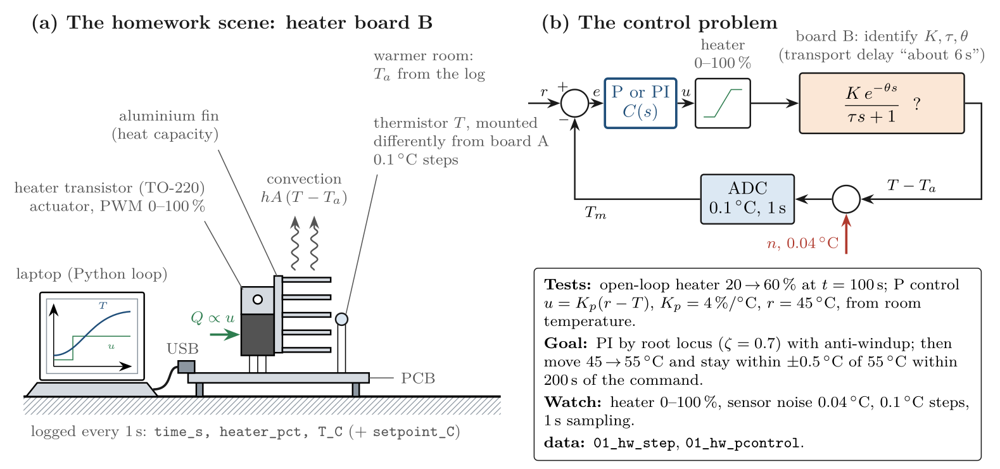

# Homework, Lab 01: temperature control of heater board B (100 points)

Your lab group received **board B**, a second heater-and-sensor board. It sits in a warmer room and its
thermistor is mounted differently from the demo board, so you cannot reuse the demo numbers. Two logs
(simulated, see the `.json` files) are provided:

- `data/01_hw_step.csv`: open-loop test. The board was held at 20 % heater until steady, then stepped to
  60 % at t = 100 s. Columns `time_s`, `heater_pct`, `T_C`; 1 s sampling, 0.1 degC sensor resolution.
- `data/01_hw_pcontrol.csv`: the board under proportional control $u = K_p (r - T)$, $K_p = 4$ %/degC,
  set point 45 degC, starting at room temperature; heater clipped to 0-100 %.

The board's documentation states a heater-to-sensor transport delay of "about 6 s". Start from
`hw_starter.py`. Use `ctrlprac` (`ident.fit_fopdt`, `sim.PID`, `sim.simulate_loop`) and python-control.
Hand in one PDF with the plots and numbers requested, and your script.

## Problem 1. Model from the step test (15 points; L6-L7)

a. (8) Fit $G(s) = K e^{-\theta s}/(\tau s + 1)$ to `01_hw_step`. Report $K$ (degC/%), $\tau$, $\theta$ (s),
   the initial temperature and the RMS fit error. Plot the log with the fit and the residual.
b. (4) Check $K$ and $\theta + \tau$ graphically (final rise and 63 % point) and compare with the fit.
c. (3) The fitted $\theta$ is much larger than the 6 s transport delay. Give a physical reason.

## Problem 2. What proportional control can and cannot do (15 points; L12, L26)

a. (5) From `01_hw_pcontrol`, measure the steady-state error and compare with
   $e_{ss} = (r - T_a)/(1 + K K_p)$ using your $K$. Explain the initial heater value in the log.
b. (5) Which $K_p$ would make $e_{ss} \le 1$ degC for this set point?
c. (5) Find the ultimate gain $K_u$ (P gain at which the loop with the *exact* delay goes unstable) and its
   oscillation period. Can the $K_p$ of part b be used? Why does a PI controller solve this?

## Problem 3. PI design with the root locus (25 points; L13-L17, L19)

a. (5) Replace the delay by a first-order Pade approximation. Write the rational model and give its pole
   and zero. Why is the zero a problem for high gain?
b. (10) With $C(s) = K_c (s + z)/s$ and $z = 1/\tau$, plot the root locus and find $K_c$ for a dominant pair
   with $\zeta = 0.7$. Report $K_p$, $K_i$, the closed-loop poles, $\omega_n$ and the estimated 2 % settling time.
c. (10) Find the gain at which the Pade-model locus crosses the $j\omega$ axis and the crossing frequency.
   Compare with the gain at which the loop with the exact delay becomes unstable (use $K_c \cdot GM$).
   Is the Pade model optimistic or pessimistic here?

## Problem 4. Implementation: saturation, windup and robustness (15 points; L19)

Simulate on your identified model (with its delay), 1 s sampling, heater limited to 0-100 %, sensor noise
0.04 degC and 0.1 degC resolution, from room temperature to $r = 55$ degC.

a. (8) Run `sim.PID` with and without anti-windup. Report overshoot, 2 % settling time, and how long the
   heater sits at 100 %. Explain the difference in one paragraph.
b. (7) Robustness: rerun (with anti-windup) on a plant with 20 % higher gain and 50 % longer delay.
   Report overshoot, settling, PM and GM. Would you ship this controller to a board you have not tested?

## Problem 5. Margins from Bode and Nyquist (15 points; L20-L26)

a. (10) For $L(s) = C(s) G(s) e^{-\theta s}$ (exact delay) find $\omega_c$, PM, $\omega_{180}$, GM (and in dB).
   Show both on a Bode plot and draw the Nyquist plot.
b. (5) Compute the delay margin $PM/\omega_c$. Compare PM and GM with those of the Pade(1) model. Which
   margin does the Pade approximation get wrong, and why?

## Problem 6. Engineering judgement (15 points)

A customer wants board B to move from 45 to 55 degC and stay within $\pm 0.5$ degC of 55 degC within
**200 s** of the command. Simulate the 45 -> 55 degC change (identified model, saturation on) with
(i) your PI of Problem 3, and (ii) the PI gain raised until PM = 45 deg (same zero). Report the time to
enter and stay in the band, and the crossover frequencies. Then answer in at most half a page: can the
specification be met by tuning alone? If not, what would you change on the board, and what
does Problem 5 tell you about how much it would help? Support the answer with one more simulation.
