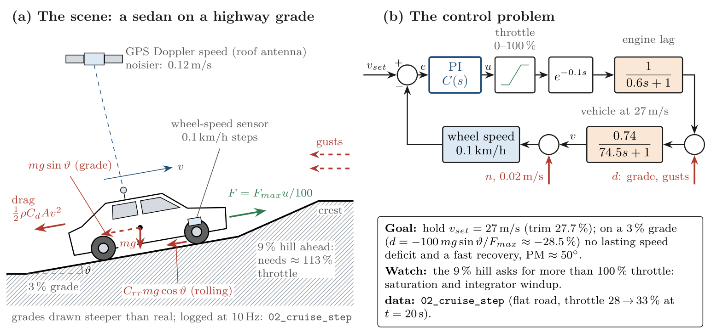

# Lab 02: vehicle cruise control

A car at highway speed is a mass pushed by the engine against aerodynamic drag, rolling resistance and
gravity on grades. We build the model from physics, identify it from a logged throttle step, treat a hill as
a disturbance (why P control leaves a speed deficit and PI removes it), place the PI zero on the root locus,
compare a lag compensator with PI, and see the throttle saturate and the integrator wind up on a steep hill.



## System and parameters

$m_{eff}\dot v = F - \tfrac12\rho C_d A v^2 - C_{rr} m g\cos\vartheta - m g\sin\vartheta - F_{gust}$,
$\tau_e \dot F = F_{max} u/100 - F$ (after a short actuation delay), $u$ = throttle 0-100 %.
Linearized about $v_0$ on a flat road: $G(s) = \dfrac{K}{(\tau s+1)(\tau_e s+1)}$, $b = \rho C_d A v_0$,
$K = F_{max}/(100\,b)$, $\tau = m_{eff}/b$. A grade enters at the plant input as $d = -100\,m g\sin\vartheta/F_{max}$ (% throttle).

| quantity | demo: mid-size sedan | homework: mid-size SUV | basis |
|---|---|---|---|
| mass $m$ / effective $m_{eff}$ | 1550 / 1610 kg | 2050 / 2130 kg | representative values |
| $C_d$, frontal area $A$ | 0.29, 2.30 m$^2$ | 0.35, 2.80 m$^2$ | representative |
| rolling coefficient $C_{rr}$ | 0.010 | 0.011 | representative (highway tyres) |
| $F_{max}$ (full throttle, top gear) | 1600 N | 2200 N | torque x overall ratio / wheel radius, representative |
| engine lag $\tau_e$, delay | 0.6 s, 0.1 s | about 0.8 s, identify from the log | representative |
| cruise speed $v_0$ | 27 m/s | 25 m/s | |
| linearized $b$, $K$, $\tau$ | 21.6 N s/m, 0.740 (m/s)/%, 74.5 s | compute (homework Problem 1a) | computed |
| sensors (10 Hz) | wheel speed 0.1 km/h steps + 0.02 m/s noise; GPS speed 0.12 m/s noise | same | representative |

The logs in `data/02_*.csv` are **simulated** from the nonlinear model above with wind-gust forces (15 N rms);
the demo `.json` sidecar gives the parameters and seed; the homework sidecars give only the test
conditions and the values stated in `homework.md`. They are not measurements from a real vehicle.

## Tool map

| step | course tool | lecture |
|---|---|---|
| physics model and linearization vs logged throttle step (`demo_1_model_ident.py`) | modeling, first-order step response | L3, L6-L7 |
| grade as an input disturbance, P control speed deficit (`demo_2_grade_p_control.py`) | block diagrams, steady-state error | L2, L12 |
| P-gain limit from the locus with a Pade delay (`demo_2`) | root locus | L13-L15 |
| PI zero placement: PM vs hill recovery; lag vs PI (`demo_3_pi_lag_rootlocus.py`) | root locus design, lag compensator | L13-L18 |
| 9 % hill: throttle saturation, windup, clamping anti-windup (`demo_4_steep_hill_windup.py`) | PID implementation | L19 |
| margins of the final loop, identified vs true model (`demo_4`) | Bode, gain/phase margins | L20-L22, L26 |

Key demo results (sedan): identified $K$ = 0.653 (m/s)/%, $\tau$ = 66 s vs 0.740 and 74.5 s from the tangent at
27 m/s (the step spans 27.2-30.5 m/s; the chord model gives 0.693 and 70 s). P gain for $\zeta$ = 0.7:
22.6 %/(m/s), leaving 1.2 m/s deficit on 3 %. PI zero 0.049 rad/s (PM = 50 deg): recovery 42 s vs 117 s for the
cancelling zero. On the 9 % hill, no anti-windup overshoots by about 10 m/s after the crest; with clamping, 0.65 m/s.

## Files

- `figures/scene.tex`, `figures/scene_hw.tex`: TikZ sources of the scene figures (build with `tools/build_figures.sh 02_`).
- `_make_data.py` writes the logs (deterministic). `_model.py`: vehicle model and helpers.
- `demo_1` ... `demo_4`: classroom demos (jupytext percent format). `homework.md`, `hw_starter.py`: the SUV homework.

## How to run

**Get the materials once.** Clone the repository or download it as a zip file (see
[Get the materials](../../README.md#get-the-materials)), and put the folder on a local disk, not inside Google
Drive, OneDrive or iCloud. Every command below is typed in a terminal (macOS: Terminal; Windows: PowerShell)
inside that folder. It is called `control-in-practice` after `git clone` and `control-in-practice-main` after
unzipping; `cd control-in-practice*` works for both.

**Option 1: JupyterLab in Docker (recommended).** Install [Docker Desktop](https://www.docker.com/products/docker-desktop/)
and start it, then run

```bash
cd control-in-practice*
docker compose up --build         # the first time builds the image (a few minutes); afterwards: docker compose up
```

When the terminal shows a line with `http://127.0.0.1:8888/lab`, open http://localhost:8888 in your browser. In
the file browser on the left, open `notebooks/02_cruise/` and double-click a notebook. Run its cells in order with
Shift+Enter; the figures appear under the cells. The notebooks of this lab are

| notebook | content |
|---|---|
| `demo_1_model_ident.ipynb` | a cruise-control model from physics and from a logged throttle step (L3, L6-L7) |
| `demo_2_grade_p_control.ipynb` | a hill is a disturbance, and P control cannot fully reject it (L2, L12, L13) |
| `demo_3_pi_lag_rootlocus.ipynb` | where to put the PI zero, and lag vs PI (L13-L18) |
| `demo_4_steep_hill_windup.ipynb` | a steep hill saturates the throttle, and the integrator winds up (L19, L26) |
| `hw_starter.ipynb` | starter for the homework |

Your changes are saved in the folder on your disk. To stop, press Ctrl+C in the terminal and then run
`docker compose down`. To run all demos and the homework starter of this lab without the browser, use

```bash
docker compose run --rm lab python run_all.py 02_
```

The printed numbers appear in the terminal and the figures are saved in `out/` as `02_cruise_<script>_<n>.png`.

**Option 2: Python on your own computer.** You need Python 3.11 or newer. Set up an environment once:

```bash
cd control-in-practice*
python -m venv .venv
source .venv/bin/activate         # Windows PowerShell: .venv\Scripts\Activate.ps1
python -m pip install -r requirements.txt
```

In every new terminal, activate the environment again and tell Python where `ctrlprac` is:

```bash
cd control-in-practice*
source .venv/bin/activate         # Windows PowerShell: .venv\Scripts\Activate.ps1
export PYTHONPATH=$PWD            # Windows PowerShell: $env:PYTHONPATH = $PWD
python labs/02_cruise/demo_1_model_ident.py         # one demo; each figure opens in a window, close it to continue
python run_all.py 02_               # all demos and hw_starter.py of this lab, figures saved in out/
jupyter lab                       # the same notebooks as in Option 1, in your browser
```

**Homework.** Write your solution in `labs/02_cruise/hw_starter.py` (run it with `python labs/02_cruise/hw_starter.py`)
or in `notebooks/02_cruise/hw_starter.ipynb`, and submit the file you worked in. The two start out identical but are
separate files, so pick one and stay with it.
