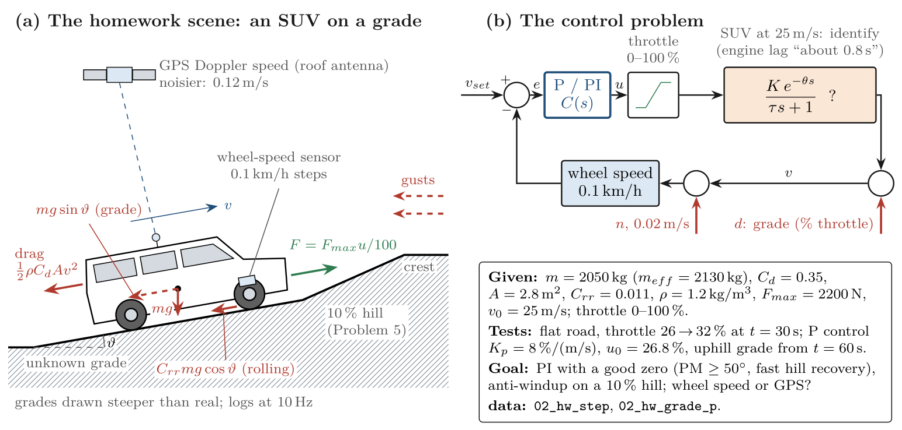

# Homework, Lab 02: cruise control of a mid-size SUV (100 points)

You are tuning the cruise controller of a mid-size SUV (not the sedan of the demos). Representative values:
mass $m$ = 2050 kg (effective mass with rotating parts $m_{eff}$ = 2130 kg), $C_d$ = 0.35, frontal area
$A$ = 2.8 m$^2$, rolling coefficient $C_{rr}$ = 0.011, air density 1.2 kg/m$^3$, full-throttle tractive force in
top gear $F_{max}$ = 2200 N (throttle 0-100 %, $F = F_{max} u/100$), engine lag about 0.8 s, cruise speed
$v_0$ = 25 m/s (90 km/h). The loop runs at 10 Hz. Two logs (simulated, see the `.json` files):

- `data/02_hw_step.csv`: flat road, throttle held at 26 % until steady, stepped to 32 % at t = 30 s.
- `data/02_hw_grade_p.csv`: the SUV under P cruise control $u = u_0 + K_p (v_{set} - v)$, $K_p$ = 8 %/(m/s),
  $u_0$ = 26.8 %, $v_{set}$ = 25 m/s. At t = 60 s the road turns into an uphill grade of unknown size.

Columns: `time_s`, (`setpoint_mps`), `throttle_pct`, `speed_wheel_mps` (wheel-speed sensor, 0.1 km/h
resolution), `speed_gps_mps` (GPS Doppler speed). Start from `hw_starter.py`.

**Simulation convention.** Simulate the loop in deviation variables: plant = your identified
$K/(\tau s+1)$ with `delay` = your $\theta$, `y0` = 25, throttle limits `u_lim = (-u0, 100 - u0)` with the
trim $u_0$ of Problem 1a, and the grade as a disturbance `d(t)` in % throttle. Use `sim.simulate_loop`,
`sim.PID`, `sim.LTIController`.

## Problem 1. Physics vs data (15 points; L3, L6-L7)

a. (5) Linearize the drag about 25 m/s: give $b$, $K = (F_{max}/100)/b$, $\tau = m_{eff}/b$ and the trim throttle.
b. (6) Fit a FOPDT model to the wheel-speed and to the GPS signal of `02_hw_step`. Report $K$, $\tau$, $\theta$,
   RMS error for both, and the $b$ and $m_{eff}$ implied by the wheel-speed fit.
c. (4) Explain the gap between 1a and 1b. Which single change to the physics model closes most of it?

## Problem 2. A hill as a disturbance (15 points; L2, L12)

a. (4) Draw the block diagram with the grade as a disturbance; write $V(s)$ in terms of $R(s)$ and $D(s)$.
b. (5) From `02_hw_grade_p`, measure the steady speed drop and throttle increase after the grade.
c. (6) Using your $K$ and $K_p$, infer the disturbance in % throttle and the grade in %. Why can P control
   never remove this drop?

## Problem 3. Root-locus design of the PI zero (25 points; L13-L17, L19)

a. (8) With a Pade(1) model of $\theta$, find the P gain $K_c$ that gives $\zeta$ = 0.7. Report the poles, PM, GM
   and the predicted speed drop on a 3 % grade.
b. (10) Keep $K_c$ and add $C(s) = K_c(s + z)/s$. Sweep $z$ from $1/\tau$ to 0.2 rad/s; for each value compute
   the PM (exact delay) and the time to recover within 0.2 m/s after a 3 % grade. Plot both against $z$
   and choose $z$ (state your criterion; e.g. PM >= 50 deg). Report $K_p$, $K_i$, PM, GM.
c. (7) Plot the root locus for your $z$ and for $z = 1/\tau$. Use the closed-loop poles to explain why the
   "pole-zero cancellation" choice recovers slowly from a hill.

## Problem 4. Lag compensator vs PI (15 points; L18)

Design a lag $C(s) = K_c (s + z)/(s + p)$ with your $K_c$, $z$ and $z/p$ = 10. Simulate P, lag and PI on a 3 %
grade at t = 20 s for 400 s. Report the maximum drop, the error at 400 s and the recovery time; compare the
lag's error with $K|d|/(1 + K K_c z/p)$. When would you accept a lag instead of a PI?

## Problem 5. A steep hill: saturation and windup (15 points; L19, L26)

a. (3) What throttle does a 10 % grade need at 25 m/s? What happens to the loop?
b. (8) Simulate a 10 % grade between t = 20 and 85 s (5 s ramps) with the PI, with and without anti-windup.
   Report minimum speed, overshoot after the crest, time to return within 0.3 m/s, time at full throttle.
c. (4) Give PM, GM and delay margin of your final loop on a Bode plot.

## Problem 6. Engineering judgement (15 points)

Write a half-page recommendation for the production cruise controller of this SUV: structure and gains,
anti-windup, and what the vehicle should do on grades it cannot hold in top gear. A colleague proposes
feeding back GPS speed instead of wheel speed. Estimate each sensor's noise from the flat part of
`02_hw_grade_p` and the resulting throttle noise ($\approx K_c \sigma$), and use these numbers in your answer.
