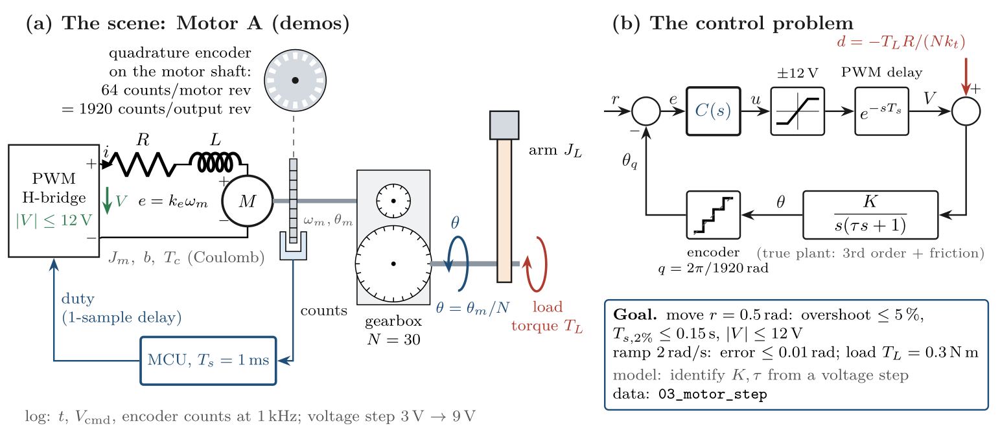

# Lab 03: DC gearmotor position control with an encoder

A brushed DC gearmotor turns an arm; a quadrature encoder on the motor shaft is read at 1 kHz and a PWM
stage applies at most 12 V. We go from the physics to the dominant-pole model K/(s(tau s+1)), identify
K and tau from a logged voltage step, and design the position loop on the root locus: P, PD, lead (the
realizable PD, with encoder quantization on the derivative) and lag/PI for steady-state error, all tested
with saturation, delay and quantization.

## Physics and parameters

Armature: L di/dt = V - R i - ke w_m. Rotor plus reflected load: J dw_m/dt = kt i - b w_m - T_c sgn(w_m)
- T_L/N, with J = Jm + JL/N^2. Output angle theta = theta_m/N. Hence

    G(s) = Theta(s)/V(s) = (kt/N) / ( s [ (L s + R)(J s + b) + kt ke ] )  ~  K / ( s (tau s + 1) ),
    K = kt / (N (R b + kt^2)),   tau = R J / (R b + kt^2).

| Parameter | Motor A (demos) | Motor B (homework) | basis |
|---|---|---|---|
| R, L | 2.4 ohm, 2.0 mH | 1.9 ohm, 1.1 mH | representative values, 12 V 37 mm-class motor |
| kt = ke | 0.019 N m/A | 0.0235 N m/A | representative |
| Jm, JL | 3.3e-6, 2.0e-3 kg m^2 | 4.5e-6, 6.0e-3 kg m^2 | rotor; small arm at the output |
| N, b, T_c | 30, 2e-6 N m s/rad, 2e-3 N m | 50, 3e-6, not listed (estimate from the log) | gearbox; friction at the motor |
| encoder | 64 counts/motor rev (1920/output rev) | 48 (2400/output rev) | quadrature |
| PWM limit, Ts | 12 V, 1 ms (one-sample update delay) | same | |

Poles of Motor A: -1172, -28.3, 0 1/s (electrical pole 41 times faster than the mechanical one).
The data are **simulated** (`data/03_motor_*.json` says `"source": "simulated"`; the demo sidecar holds the
true values, the homework sidecar only the datasheet values and test conditions):
nonlinear model with Coulomb friction, PWM ripple and delay, integer encoder counts.

## Tool map

| Step | Course tool | Lecture |
|---|---|---|
| Electrical + mechanical model, Theta(s)/V(s) | modeling, transfer functions | L3, L4 |
| Neglect L: K/(s(tau s+1)) | dominant poles | L8 |
| K, tau from a voltage step on speed (`fit_fopdt`) | step response vs parameters | L6, L7 |
| P control, why Ts cannot be shortened by gain | root locus | L13 |
| Overshoot/settling specs as an s-plane region | pole locations | L16 |
| PD by the angle condition | transient design with root locus | L17 |
| Closed-loop zero raises overshoot | effect of zeros | L9 |
| Lead = realizable PD; quantization noise on the derivative | lead | L18 |
| Ramp error, constant load torque: lag or PI | steady-state error, lag | L12, L18 |
| Saturation, delay, quantization (`simulate_loop`) | sampled-data test | L19 |

## Files

- `demo_motor_1_model_ident.py`: physics, dominant pole, identification from `data/03_motor_step`.
- `demo_motor_2_root_locus_pd.py`: specs, P root locus, PD design and the effect of its zero.
- `demo_motor_3_lead_lag_hw.py`: lead vs PD with an encoder, lag/PI for ramp and load, 12 V limit and windup.
- `homework.md`, `hw_starter.py`: Motor B (`data/03_motor_hw_step`).
- `_model.py` (lab helpers), `_make_data.py` (regenerates the data), `figures/scene.tex` and `scene_hw.tex` (TikZ source of the scene figures; `tools/build_figures.sh 03_`).

## Run

Docker: `docker compose up`, open http://localhost:8888, then open the demos as notebooks (jupytext).
Local: `cd control-in-practice && PYTHONPATH=. python labs/03_motor/_make_data.py` (only to regenerate
data), then `cd labs/03_motor && PYTHONPATH=../.. python demo_motor_1_model_ident.py`.
All scripts headless: `PYTHONPATH=. python run_all.py 03_` (figures in `out/`).
