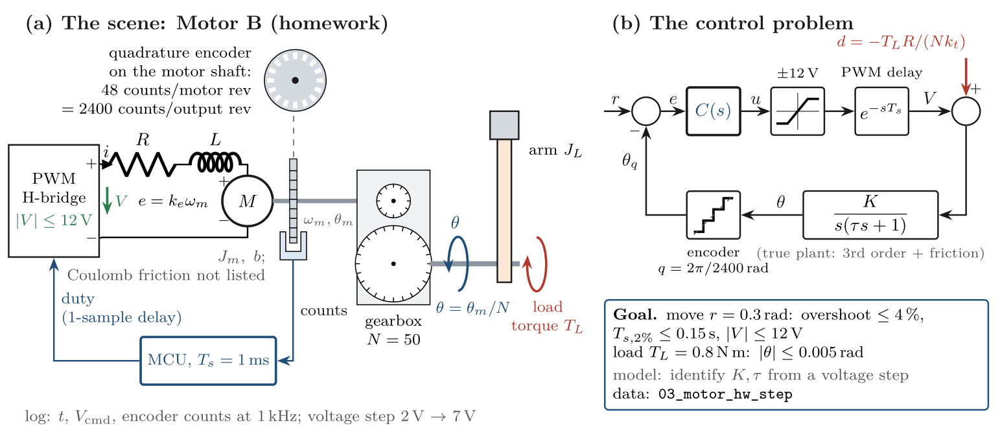

# Lab 03 homework: position control of Motor B (100 points)

Your team must position a heavier arm with a different gearmotor, **Motor B**. You get its datasheet-class
values and one logged voltage step. Design the position loop and test it as if it were the hardware.

**Data.** `data/03_motor_hw_step.csv` (simulated log, see the `.json`): time `t (s)`, voltage command
`V_cmd (V)` (2 V to 7 V at t = 0.25 s), and the raw encoder count `encoder (counts)`, logged at 1 kHz.
Start from `hw_starter.py`. Helpers you may use: `ctrlprac.ident`, `ctrlprac.sim`, and `_model.py`
(`MOTOR_B`, `full_tf`, `speed_from_counts`, `pd_by_angle`, `lead_by_angle`, `step_specs`).

| Motor B (representative values) | value |
|---|---|
| armature resistance R, inductance L | 1.9 ohm, 1.1 mH |
| torque constant kt = back-emf constant ke | 0.0235 N m/A |
| rotor inertia Jm; load inertia at the output JL | 4.5e-6 kg m^2; 6.0e-3 kg m^2 |
| gear ratio N; viscous friction at the motor b | 50; 3.0e-6 N m s/rad |
| encoder | 48 counts per motor revolution (quadrature) |
| PWM limit, sample time | 12 V, 1 ms |

**Specs for the move.** 0.3 rad step of the arm: overshoot at most 4 %, 2 % settling time at most 0.15 s,
|V| at most 12 V. **Load.** A constant load torque of 0.8 N m at the output must not move the arm by more
than 0.005 rad in steady state.

1. **Model and dominant pole (10 pts, L3, L8).** Derive Theta(s)/V(s), compute its poles, and the ratio of
   the electrical to the mechanical pole. Give K and tau of K/(s(tau s+1)) from the parameters, and say
   which tau (formula with L = 0, or 1/|mechanical pole|) you expect a step test to return.
2. **Identification from the log (20 pts, L7).** Convert counts to output speed. Compare a 1-sample and a
   10-sample difference: what is the speed resolution of each? Fit K, tau (and dead time) with
   `fit_fopdt` on the speed increment; plot data and fit; state the error relative to Part 1. Explain why
   the speed before the step is lower than K x 2 V, and estimate the friction voltage.
3. **P control (10 pts, L13, L16).** Translate the specs into a region of the s-plane. Plot the root locus
   of K/(s(tau s+1)) under P control, show why the settling spec cannot be met by any Kp, and give the
   largest Kp that meets the overshoot spec (with its settling time).
4. **PD design (20 pts, L17, L9).** Using the angle condition, design C(s) = Kd (s + z) for a target pole
   with sigma = 28 1/s and zeta = 0.70, 0.80, 0.85. For each give z, Kd, Kp, the overshoot and settling
   time of the closed loop, and of a second-order system with the same poles but no zero. Which designs
   meet the specs and the 12 V limit (proportional part Kp r)? Explain the role of the closed-loop zero.
5. **Lead and the encoder (15 pts, L18).** Design a lead C(s) = Kc (s + 1/tau)/(s + p) for zeta = 0.85,
   sigma = 28. Simulate it and the PD (implemented with `PID(..., Tf=Ts/50)`) with `simulate_loop` on the
   **third-order** plant with `u_lim=(-12, 12)` and the encoder quantization. `simulate_loop` applies each
   voltage one sample after the encoder reading it was computed from, which is the 1 ms PWM update delay
   of the hardware, so leave `delay` at 0. Report overshoot, settling time, peak voltage and the rms
   sample-to-sample voltage change. Explain the size of the PD voltage jumps from Kd, the count size, and Ts.
6. **Load torque (15 pts, L12, L18).** Convert 0.8 N m at the output into an equivalent input voltage
   and compute the steady-state error with the lead alone. Design a lag (beta from the spec, zero at
   sigma/10) and a PI (C_lead (s + z_g)/s). Simulate the load step (from rest, load applied at 0.5 s) and
   the 0.3 rad move with each. Report the load error after 1 s and at the end, and the new step overshoot.
   Repeat with z_g = sigma/20 and sigma/40, and explain the trade-off with the closed-loop pole-zero pair
   near the origin.
7. **Engineering judgement (10 pts).** Purchasing proposes (a) a cheaper encoder with 12 counts per motor
   revolution, and (b) doubling the lead gain instead of adding integral action, "to halve the load
   error". Using your numbers (quantization, voltage chatter, overshoot, saturation, load error), say what
   you would accept for this arm, and what you would recommend instead, in at most 150 words.

**Deliverables.** One PDF with the plots (labelled axes and units), a table of the numbers asked for, and
your code (`hw_starter.py` completed).
