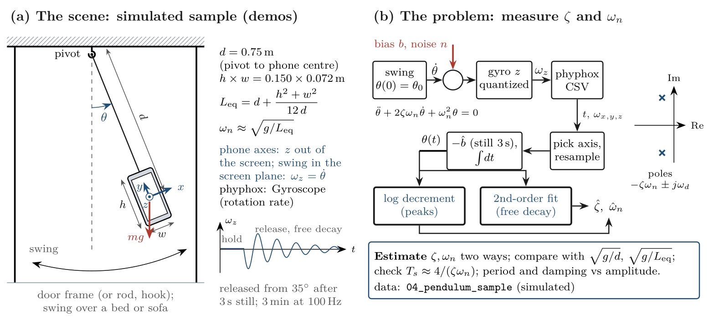

# Lab 04: a phone pendulum, measured by you



Hang your phone on a string, release it, and record its gyroscope with the free phyphox app. The free
decay of the swing is a lightly damped second-order system: from it you estimate zeta and omega_n (log
decrement and a second-order fit), compare omega_n with the length, place the poles in the s-plane,
check the settling-time formula, and see where the linear model breaks (large angles, air drag).

**The sample file `data/04_pendulum_sample.csv` is simulated** (its JSON says `"source": "simulated"`).
It only shows the format and lets the demos run. Replace it with your own recording (save yours as
`data/04_pendulum_my_recording.csv`; the homework uses that name).

## Physics

Point mass on a massless string: theta'' + (g/d) sin(theta) = 0, so omega_n = sqrt(g/d) for small angles.
The phone is a body, not a point: as an h x w plate swinging in its own plane, I_pivot = m d^2 +
m (h^2 + w^2)/12, and omega_n = sqrt(g/L_eq) with L_eq = d + (h^2 + w^2)/(12 d) (physical pendulum).
Damping: pivot/string friction (about linear in speed) plus air drag (about quadratic in speed), so the
equivalent zeta grows with amplitude. At amplitude theta_a the period is T0 (1 + theta_a^2/16 + ...).
Sample values (representative): d = 0.75 m, phone 0.150 x 0.072 m, released from 35 deg.

## How to record (10 minutes)

1. Install **phyphox** (free, RWTH Aachen; iOS and Android). Open **Gyroscope (rotation rate)**.
2. Put the phone in a case or a zip bag and tie it to a string (or two strings in a V, which stops it
   twisting). Hang it from a door frame, a rod or a hook, with 0.5 to 1.5 m from the pivot to the phone
   centre. Swing over a bed or sofa, clear of the door and of people. Keep the phone **upright, screen
   facing you, and swing it left-right in the plane of the screen** (rotation about the phone's z axis).
   Other orientations work too; the loader picks the axis with the most motion.
3. Measure **d, from the pivot to the centre of the phone**, with a tape measure (to about 0.5 cm), and
   the phone height and width. Take a photo of the setup with the tape visible.
4. Pull the phone aside by **20 to 30 degrees**, press the play button, **hold it still for 3 s**, then let
   go without pushing. Do not touch anything for **3 minutes**, then stop. Default sampling (about
   100 Hz or more) is fine; anything above 50 Hz works.
5. Optional (homework Problem 7): a second run released from about 60 degrees.
6. Export: the three-dots menu, **Export Data**, **CSV (Comma, decimal point)** (tab or semicolon also
   load). From the zip, keep only **Gyroscope.csv** and copy it to `data/04_pendulum_my_recording.csv`.

**Privacy.** The gyroscope experiment records only rotation rates and time; phyphox does not record your
location for it, and nothing leaves your phone until you export. The export zip also holds a `meta/`
folder with your phone model and the absolute start time: **do not submit it**, submit only the
gyroscope CSV. In the setup photo, show the pendulum and the tape, not people or personal items.

## Tool map

| Step | Course tool | Lecture |
|---|---|---|
| Linearize theta'' + (g/L) sin theta = 0 at the bottom | modeling, first/second order systems | L3, L6 |
| zeta, omega_n from the peaks (`log_decrement`) | step/free response vs parameters | L7 |
| zeta, omega_n from the whole decay (`fit_second_order_step` on the angle) | second-order response, dominant poles | L6, L8 |
| omega_n vs sqrt(g/d) and sqrt(g/L_eq) | modeling (physical pendulum) | L3 |
| Poles -zeta omega_n +/- j omega_d; Ts = 4/(zeta omega_n) | pole locations and the response | L16 |
| Period and damping vs amplitude | limits of linearization | L3, L6 |

## Files

- `demo_pendulum_1_decay.py`: loading, log decrement, second-order fit, length, poles, settling.
- `demo_pendulum_2_nonlinear.py`: period vs amplitude, damping vs amplitude, envelope prediction.
- `homework.md`, `hw_starter.py`: uses your recording; `data/04_pendulum_hw_backup.csv` (simulated) only
  for students without a phone.
- `_model.py`: `load_phyphox` (comma, tab or semicolon separated, decimal point or comma, any axis,
  ignores the "Absolute" column, resamples jittery time stamps to a uniform grid), release detection,
  bias/drift removal, cycle analysis.
- `_make_data.py` (the simulated sample), `figures/scene.tex` and `scene_hw.tex` (TikZ source of the
  scene figures; `tools/build_figures.sh 04_`).

**Your own recording in the demos.** In `demo_pendulum_1_decay.py`, change `name = '04_pendulum_sample'` to
`name = '04_pendulum_my_recording'` and set d and the phone size in the demo (the sample reads them from its JSON).

## How to run

**Get the materials once.** Clone the repository or download it as a zip file (see
[Get the materials](../../README.md#get-the-materials)), and put the folder on a local disk, not inside Google
Drive, OneDrive or iCloud. Every command below is typed in a terminal (macOS: Terminal; Windows: PowerShell)
inside that folder. It is called `control-in-practice` after `git clone` and `control-in-practice-main` after
unzipping; `cd control-in-practice*` works for both.

**Option 1: JupyterLab in Docker (recommended).** Install [Docker Desktop](https://www.docker.com/products/docker-desktop/)
and start it, then run

```bash
cd control-in-practice*
docker compose up --build         # the first time builds the image (a few minutes); afterwards: docker compose up
```

When the terminal shows a line with `http://127.0.0.1:8888/lab`, open http://localhost:8888 in your browser. In
the file browser on the left, open `notebooks/04_pendulum/` and double-click a notebook. Run its cells in order with
Shift+Enter; the figures appear under the cells. The notebooks of this lab are

| notebook | content |
|---|---|
| `demo_pendulum_1_decay.ipynb` | a phone pendulum, damping and natural frequency from a free decay |
| `demo_pendulum_2_nonlinear.ipynb` | where the linear second-order model stops: large angles and air drag |
| `hw_starter.ipynb` | starter for the homework |

Your changes are saved in the folder on your disk. To stop, press Ctrl+C in the terminal and then run
`docker compose down`. To run all demos and the homework starter of this lab without the browser, use

```bash
docker compose run --rm lab python run_all.py 04_
```

The printed numbers appear in the terminal and the figures are saved in `out/` as `04_pendulum_<script>_<n>.png`.

**Option 2: Python on your own computer.** You need Python 3.11 or newer. Set up an environment once:

```bash
cd control-in-practice*
python -m venv .venv
source .venv/bin/activate         # Windows PowerShell: .venv\Scripts\Activate.ps1
python -m pip install -r requirements.txt
```

In every new terminal, activate the environment again and tell Python where `ctrlprac` is:

```bash
cd control-in-practice*
source .venv/bin/activate         # Windows PowerShell: .venv\Scripts\Activate.ps1
export PYTHONPATH=$PWD            # Windows PowerShell: $env:PYTHONPATH = $PWD
python labs/04_pendulum/demo_pendulum_1_decay.py         # one demo; each figure opens in a window, close it to continue
python run_all.py 04_               # all demos and hw_starter.py of this lab, figures saved in out/
jupyter lab                       # the same notebooks as in Option 1, in your browser
```

**Homework.** Write your solution in `labs/04_pendulum/hw_starter.py` (run it with `python labs/04_pendulum/hw_starter.py`)
or in `notebooks/04_pendulum/hw_starter.ipynb`, and submit the file you worked in. The two start out identical but are
separate files, so pick one and stay with it.
