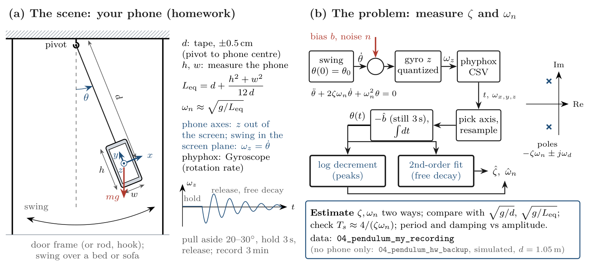

# Lab 04 homework: your own phone pendulum (100 points)

**This homework requires your own recording.** Follow "How to record" in `README.md` (phyphox,
Gyroscope (rotation rate), hold still 3 s, release from 20 to 30 deg, 3 minutes, export CSV). Save it as
`data/04_pendulum_my_recording.csv` and set your measured d and phone size in `hw_starter.py`.
Only if you have no phone: use `data/04_pendulum_hw_backup.csv` (simulated; d = 1.05 m, phone
0.150 x 0.072 m) and say so in your report; the backup is graded the same way.

**Your code and the web demo.** Every number in your report must come from your own script, which you
build from `hw_starter.py` and submit. The interactive demo on the course page can load your recording
and computes several of the basic quantities (the release, the bias, a log decrement, a second-order fit,
the poles and a settling time). You may use it to check your numbers, and you should say in the report
where your results and the demo agree. Numbers copied from the demo without the code that produces them
earn no credit. Most of the points are for the parts the demo does not do for you: choosing the data
ranges and justifying the choice, estimating uncertainties and propagating them, the plots you make, the
comparisons between methods, and the explanations.

**Deliverables.** (i) your gyroscope CSV (only `Gyroscope.csv`, not the `meta/` folder), (ii) a photo of
the setup with the tape measure visible (no people), (iii) your measured d, h, w with an uncertainty,
(iv) one PDF with the plots (labelled axes, units), a table of all numbers, and the answers, (v) your code
(the completed `hw_starter.py`, which must run as submitted and reproduce every number in the table).

1. **Recording and loading (10 pts).** Load your file with `load_phyphox` and plot the three axes.
   Which axis did the loader pick? Explain from the way the phone hung why that axis carries the swing
   and what the small signals on the other two axes are. Give the mean sampling rate and the standard
   deviation of the time-stamp intervals, the duration, and the release time. Choose the still segment
   before the release yourself, justify its limits from your plot, and give the gyro bias with its
   standard error (standard deviation over the square root of the number of samples). How large an
   angle drift would a bias error of that size produce over your record? Give the release angle.
2. **Logarithmic decrement (15 pts, L7).** Smooth the bias-free gyro signal with a 0.1 s centered moving
   average. Compute the gain of this filter at omega_d and use it to show why the smoothing leaves the
   decrement unchanged. Estimate zeta, omega_d and omega_n with `log_decrement` from (a) the first 20
   peaks after the release and (b) the peaks of cycles 40 to 60. Plot ln(peak) against the peak number
   with both fitted lines, and give the standard error of each slope and the resulting uncertainty of
   zeta. Repeat (a) with 10 and 30 peaks. Explain the difference between (a) and (b), and say which
   peak range you would use to characterize the pendulum near 25 deg and why.
3. **Second-order fit (15 pts, L6, L8).** Integrate the gyro to the angle (`angle_from_gyro`) and fit
   `fit_second_order_step` from the release over a 40 s window. Report zeta, omega_n, the release angle
   -K and the rmse, overlay data and fit, and plot the residual against time. Explain why shorter
   windows can make the initial guess fail. Repeat the fit over two other windows of your choice (a
   different length, or a later start that begins at a turning point of the swing), tabulate the three
   results, and explain the trend of zeta with the window in terms of the residual you plotted.
4. **Length (15 pts, L3).** Compute omega_n from your d as a simple pendulum and as a physical
   pendulum (L_eq). Propagate the uncertainties of d, h and w to omega_n (state the formula). Compare
   with Problems 2 and 3 in percent, taking their uncertainties into account, and give the length each
   estimate implies (g/omega_n^2). Is the physical-pendulum correction larger or smaller than your
   measurement uncertainty, and do the estimates agree within the combined uncertainty?
5. **Poles (10 pts, L16).** Plot the poles from Problems 2a and 3 in the s-plane, with error bars from
   the uncertainties of Problems 2 and 4, on axes scaled so that the real parts are visible. How
   different are omega_d and omega_n? Compare your numbers with the approximation
   (omega_n - omega_d)/omega_n = zeta^2/2. What would a person who only measured the period miss?
6. **Settling time (10 pts, L16).** Predict the 2 % settling time 4/(zeta omega_n) from Problems 2a, 2b
   and 3, with the uncertainty that follows from the uncertainty of zeta. Measure it from the cycle
   amplitudes (`cycles`): the time after which the amplitude stays below 2 % of the release angle. Plot
   the measured amplitudes on a logarithmic scale with the three predicted envelopes. Explain the
   disagreement and say which damping estimate predicts the settling time best, and why.
7. **Beyond the linear model (15 pts).** With `cycles`, plot the period against the amplitude and fit
   T = T0 (1 + c A^2) by least squares in your own code. Choose the amplitude range of the fit, justify
   it, and give c with its standard error; compare c with 1/16 and the length from T0 with your d. Plot
   the 5-cycle log decrement against the amplitude and fit zeta(A) = zeta_l + (4/(3 pi)) c_q A; outline
   in a few lines the energy balance over one cycle that gives the factor 4/(3 pi). If you made the
   optional 60 deg run, include it. Up to which amplitude is the period within 1 % of T0, according to
   your fit and according to the theory?
8. **Engineering judgement (10 pts).** Your pendulum stands in for the swinging load of a small crane
   that a controller must damp. Which zeta and omega_n would you hand to the control designer, for
   which amplitude range, and with what uncertainty? Name the largest error source in your experiment
   and how you would reduce it. If any of your numbers differ from those of the web demo for the same
   settings, say which ones and why. At most 150 words.
