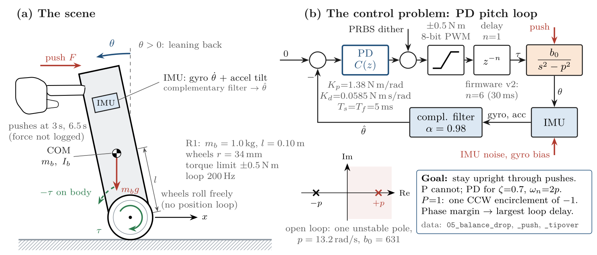

# Lab 05: two-wheeled balancing robot (pitch loop)

A hobby-class two-wheeled robot balances by driving its wheels under its centre of mass. Near upright
the pitch dynamics are an inverted pendulum with one right-half-plane pole, so P control can not work,
the Nyquist plot must encircle -1 once counter-clockwise, the gain margin becomes a range, and the phase
margin sets the largest loop delay the firmware may have. The logs show a robot that balances through
two pushes, and the same robot tipping over after a firmware change added delay.



## System and parameters

Body (mass m_b, centre of mass at height l above the axle, inertia I_b about the COM) on two wheels
(total mass m_w, radius r) driven by a torque tau. Wheels roll without slip and are free (no position
loop: this lab is the pitch loop only). Linearizing the wheel and body equations and eliminating the
wheel position:

    G(s) = theta(s)/tau(s) = b0 / (s^2 - p^2),   p^2 = a b g/(a c - b^2),   b0 = (a + b/r)/(a c - b^2)
    a = m_w + I_w/r^2 + m_b,   b = m_b l,   c = I_b + m_b l^2,   I_w = m_w r^2/2

Sign convention: theta > 0 when the body leans backward, tau > 0 drives the wheels forward; then b0 > 0
and the usual negative feedback tau = -C(s) theta balances. In `_model.py` I_b is a fixed number, so
changing m_b in `dict(M.ROBOT_A, m_b=...)` adds or removes mass at the centre of mass, and changing l moves
the body without changing its own inertia.

| | robot R1 (demos) | robot R2 (homework) |
|---|---|---|
| body mass m_b | 1.0 kg | taller and heavier than R1 |
| axle-to-COM l | 0.10 m | |
| body inertia I_b (box 0.22 x 0.06 m) | 4.3e-3 kg m^2 | |
| wheels m_w, r | 0.10 kg, 34 mm | larger wheels |
| torque limit (both motors) | +/-0.5 N m | +/-1.2 N m |
| p, b0 | 13.2 rad/s, 631 | identify from the logs |

Representative values for small geared-DC-motor balancing robots, not a specific product.
Sensing and firmware: 200 Hz loop; MEMS IMU (gyro noise 0.1 deg/s, bias 0.4 deg/s; accelerometer tilt
noise 0.3 deg), complementary filter alpha = 0.98; PD from `ctrlprac.sim.PID` with a filtered
backward-difference derivative (Tf = 5 ms); one sample of sensor + computation delay, so with the
zero-order hold the total loop delay is Td = (n + 1/2) Ts = 7.5 ms for n = 1; 8-bit PWM torque command;
a 45 deg tilt cutoff that ends a run as a fall. Logs are simulated with the nonlinear equations (sin theta,
RK4) and marked `"source": "simulated"`; the acceleration error of the accelerometer is not modelled.

## Data

| file | content |
|---|---|
| `05_balance_drop` | R1, motors off, released near upright until the 30 deg stand |
| `05_balance_push` | R1 balancing, pushed at 3 s and 6.5 s, PRBS torque dither for identification |
| `05_balance_tipover` | R1, firmware v2 with 6 samples of loop delay (Td = 32.5 ms): tips over |
| `05_hw_*` | the same three tests on robot R2 (homework) |

Columns: `time_s, theta_deg` (complementary filter), `gyro_dps, acc_tilt_deg, tau_cmd_Nm` (+ `dither_Nm`).

## Tool map

| step | course tool | lecture |
|---|---|---|
| inverted-pendulum model, RHP pole | modeling, transfer function | L3, L4 |
| p from the drop test | exponential modes, least squares | L5, L6 |
| b0 from the closed-loop log (with dither) | equation-error least squares | L3 |
| P control fails | root locus of b0 K/(s^2 - p^2) | L13 |
| stabilizing PD range | Routh-Hurwitz | L10, L11 |
| PD gains for zeta = 0.7, omega_n = 2p | root locus, angle/magnitude conditions, extra filter pole | L13-L17 |
| Bode of an unstable plant | same magnitude as b0/(s+p)^2, different phase | L22 Part 3 |
| stability with P = 1 | Nyquist criterion, one CCW encirclement | L23, L24 |
| lower and upper gain margin, PM | margins on the Nyquist/Bode plot | L26 |
| maximum loop delay | delay margin PM/omega_c, checked with `simulate_loop` and the tip-over log | L26 |

## Scripts

- `demo_balance_1_model.py`: model, drop-test and closed-loop identification, P fails, Routh range.
- `demo_balance_2_rootlocus_bode.py`: PD design on the root locus; Bode of the unstable plant.
- `demo_balance_3_nyquist_delay.py`: Nyquist with P = 1, two gain margins, PM, delay limit, simulations
  below/above the limit, the logged tip-over.
- `homework.md`, `hw_starter.py`: robot R2.
- `_model.py` (physics, nonlinear simulator, margin helpers), `_make_data.py` (regenerates the logs).

Key results for R1 (firmware gains Kp = 1.38 N m/rad, Kd = 0.0585 N m s/rad): PM = 29 deg at 6.7 Hz,
gain may drop to 22 % or rise 2.7x, total loop delay limit 19.6 ms (3 samples stable, 4 unstable); the
6-sample firmware (Td = 32.5 ms) tips over with a 33 rad/s growing oscillation, as the model predicts.

## How to run

**Get the materials once.** Clone the repository or download it as a zip file (see
[Get the materials](../../README.md#get-the-materials)), and put the folder on a local disk, not inside Google
Drive, OneDrive or iCloud. Every command below is typed in a terminal (macOS: Terminal; Windows: PowerShell)
inside that folder. It is called `control-in-practice` after `git clone` and `control-in-practice-main` after
unzipping; `cd control-in-practice*` works for both.

**Option 1: JupyterLab in Docker (recommended).** Install [Docker Desktop](https://www.docker.com/products/docker-desktop/)
and start it, then run

```bash
cd control-in-practice*
docker compose up --build         # the first time builds the image (a few minutes); afterwards: docker compose up
```

When the terminal shows a line with `http://127.0.0.1:8888/lab`, open http://localhost:8888 in your browser. In
the file browser on the left, open `notebooks/05_balance/` and double-click a notebook. Run its cells in order with
Shift+Enter; the figures appear under the cells. The notebooks of this lab are

| notebook | content |
|---|---|
| `demo_balance_1_model.ipynb` | an unstable plant, identified from logs; why P fails, Routh range for PD |
| `demo_balance_2_rootlocus_bode.ipynb` | PD design on the root locus, and the Bode plot of an unstable plant |
| `demo_balance_3_nyquist_delay.ipynb` | Nyquist with an unstable open loop, two gain margins, and the delay limit |
| `hw_starter.ipynb` | starter for the homework |

Your changes are saved in the folder on your disk. To stop, press Ctrl+C in the terminal and then run
`docker compose down`. To run all demos and the homework starter of this lab without the browser, use

```bash
docker compose run --rm lab python run_all.py 05_
```

The printed numbers appear in the terminal and the figures are saved in `out/` as `05_balance_<script>_<n>.png`.

**Option 2: Python on your own computer.** You need Python 3.11 or newer. Set up an environment once:

```bash
cd control-in-practice*
python -m venv .venv
source .venv/bin/activate         # Windows PowerShell: .venv\Scripts\Activate.ps1
python -m pip install -r requirements.txt
```

In every new terminal, activate the environment again and tell Python where `ctrlprac` is:

```bash
cd control-in-practice*
source .venv/bin/activate         # Windows PowerShell: .venv\Scripts\Activate.ps1
export PYTHONPATH=$PWD            # Windows PowerShell: $env:PYTHONPATH = $PWD
python labs/05_balance/demo_balance_1_model.py         # one demo; each figure opens in a window, close it to continue
python run_all.py 05_               # all demos and hw_starter.py of this lab, figures saved in out/
jupyter lab                       # the same notebooks as in Option 1, in your browser
```

**Homework.** Write your solution in `labs/05_balance/hw_starter.py` (run it with `python labs/05_balance/hw_starter.py`)
or in `notebooks/05_balance/hw_starter.ipynb`, and submit the file you worked in. The two start out identical but are
separate files, so pick one and stay with it.
