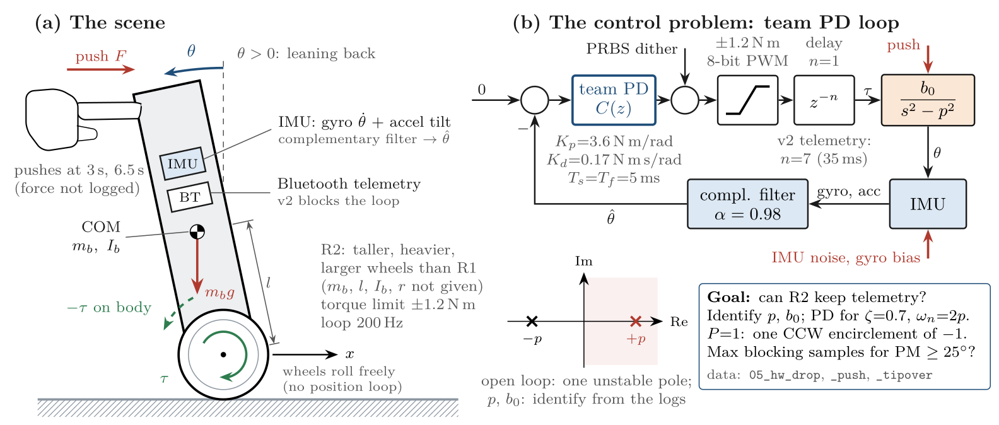

# Homework, Lab 05: will robot R2 stay up with the new telemetry? (100 points)

Robot R2 is a taller, heavier two-wheeled balancing robot (the one in the demos is R1). Its team
balances it with a hand-tuned PD loop at 200 Hz and wants to add Bluetooth telemetry. A first
firmware version with blocking telemetry tipped over. You have three logs (simulated, labelled as such
in their `.json` files; sign convention: theta > 0 = leaning backward, tau > 0 drives the wheels forward):

| file | test |
|---|---|
| `data/05_hw_drop` | motors off, body released near upright, logged until the 30 deg stand |
| `data/05_hw_push` | balancing with the team gains, pushed at t = 3 s and t = 6.5 s; PRBS torque dither for identification (`dither_Nm`) |
| `data/05_hw_tipover` | same gains, firmware v2 with blocking telemetry; loop delay in the `.json` |

The firmware PD is `ctrlprac.sim.PID(Kp, Kd=Kd, Ts=0.005, Tf=0.005)` acting on the complementary-filter
angle; the gains and delays are in the `.json` files. Use `hw_starter.py` as the starting point. Report
numbers with units and say how you obtained each.

## 1. Unstable pole from the drop test (10 pts) — L3, L10
(a) Explain why, with the motors off, theta(t) = A e^{pt} + B e^{-pt}. (b) Estimate p by least squares
(restrict to |theta| < 10 deg and say why). (c) How long does R2 take to double its tilt?

## 2. Input gain from the closed-loop log (15 pts) — L3, L10
(a) Estimate p^2 and b0 in G(s) = b0/(s^2 - p^2) from `05_hw_push` with the integrated equation-error
fit used in demo 1 (exclude the pushes; shift the torque by the loop delay). (b) Compare the two
estimates of p. (c) Why does the firmware add a dither during this test? Show the correlation between
the two regressors.

## 3. P fails, PD works (10 pts) — L10, L11, L13
(a) Sketch the root locus for C = K and explain why no K balances R2. (b) With the filtered PD of the
firmware, write the closed-loop characteristic polynomial and the Routh array; give the stabilizing range
of Kp and Kd. Are the team gains inside it?

## 4. PD design on the root locus (15 pts) — L13-L17
Design Kp, Kd for closed-loop poles with zeta = 0.7 and omega_n = 2p. Plot the root locus with your zero
fixed and mark the design. Where are the closed-loop poles when the derivative filter pole is included?
Compare your gains with the team's.

## 5. Bode plot of an unstable plant (10 pts) — L22 Part 3
Plot the Bode plots of G(s) and of the stable G_s(s) = b0/(s + p)^2 on the same axes. Explain why the
magnitudes coincide and the phases do not, and what that means for reading stability from a Bode plot.

## 6. Nyquist, margins and the delay limit (20 pts) — L23, L24, L26
For the team gains with the nominal one-sample delay, use L(jw) = C(e^{jwTs}) G(jw) e^{-jw(n + 1/2)Ts}
(the starter has `pd_frf`). (a) Draw the Nyquist plot and count the encirclements of -1; what does the
criterion require with P = 1? (b) Find both gain margins (lower and upper) and the phase margin with its
crossover frequency. (c) Convert the phase margin into the largest total loop delay and the largest
whole number of samples. (d) Confirm (c) with `ctrlprac.sim.simulate_loop` on your identified linear
model, one sample below and one above the limit (note: `simulate_loop` applies the controller output one
sample later, so `delay=(n-1)*Ts` gives n samples). (e) Repeat (b)-(c) for your design of Problem 4.

## 7. The tip-over (10 pts) — L24, L26
From `05_hw_tipover`: (a) What was the loop delay and how long did R2 stay up? (b) Estimate the
frequency of the growing oscillation from the log and compare it with the unstable closed-loop pole your
model predicts for that delay. (c) Draw the Nyquist plot for this delay and explain the tip-over with
the encirclement count.

## 8. Engineering judgement (10 pts)
The team wants telemetry back. Each telemetry frame blocks the loop for a whole number of samples.
Recommend how many samples of blocking (if any) are acceptable with (i) the team gains and (ii) your
design, keeping at least 25 deg of phase margin. Would you rather move the telemetry out of the control
loop, retune, or both? Give two or three sentences of reasoning, including one thing your linear
analysis does not capture (torque limit, sensor noise, the nonlinear sin(theta), drift of the wheels).

**Deliverables:** one PDF with the plots (labelled axes, units, legends), the numbers, and your answers;
your script.
