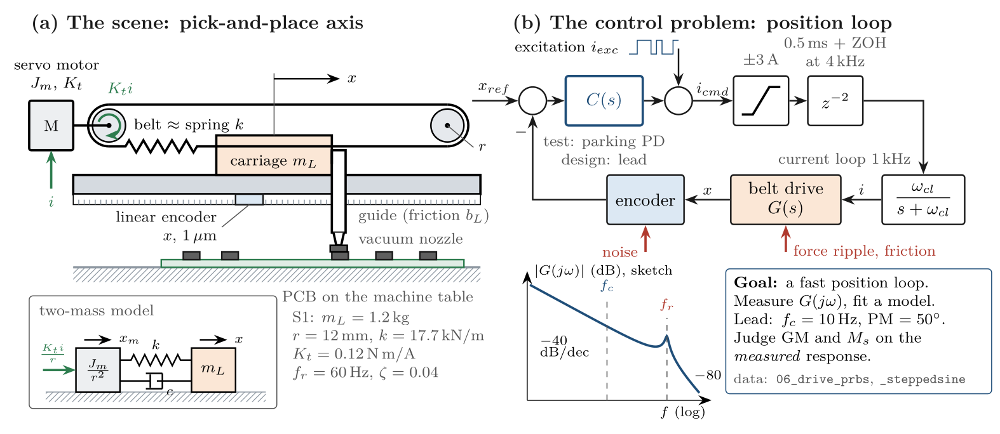

# Lab 06: belt-driven linear stage with a resonance

A servo motor moves a carriage through a timing belt. At low frequency the stage is a rigid mass, but
the elastic belt makes a lightly damped resonance in the tens of Hz, and that resonance (with the drive
delay) is what limits the position-loop bandwidth. We measure the frequency response, fit a model,
design a lead on the low-order model, and judge the design by its gain margin and sensitivity peak on
the measured response, including what goes wrong when the crossover is pushed toward the resonance.



## System and parameters

Current command i -> current loop (1 kHz, first order) -> motor torque Kt i on the motor inertia J_m ->
belt (axial stiffness k, torsional k r^2, light damping) -> carriage m_L on a linear guide (viscous
friction b_L) -> linear encoder on the carriage, x (non-collocated). Low frequency:
x/i = K/(s(s + a)), K = Kt r/J, J = J_m + m_L r^2, a = b_L r^2/J. The two-mass mode is at
w_r = sqrt(k r^2 (1/J_m + 1/(m_L r^2))); above it the slope is -80 dB/dec and the phase drops another
180 deg.

| | stage S1 (demos) | stage S2 (homework) |
|---|---|---|
| motor + pulley inertia J_m | 2.0e-5 kg m^2 | identify (via J) |
| pulley radius r | 12 mm | 15 mm (given) |
| carriage mass m_L | 1.2 kg | 2.5 kg (given) |
| belt axial stiffness k | 17.7 kN/m | identify (via f_r) |
| belt mode f_r, zeta | 60.0 Hz, 0.040 | identify from the logs |
| guide friction b_L | 8 N s/m | identify (via a) |
| torque constant Kt | 0.12 N m/A | 0.20 N m/A (given) |

Representative values for a small servo-driven belt axis (GT-type belt, 1-2 m span), not a specific
product. Drive: 4 kHz sampling, 2 samples (0.5 ms) of computation/bus delay plus the zero-order hold,
Td = 2.5 Ts = 0.625 ms in total, +/-3 A current limit, 1 um linear encoder (0.3 um noise), 0.01 A rms force
ripple/friction noise. `sim.simulate_loop` applies each command one sample late by itself, so the scripts
pass `delay=(N_DELAY - 1) * TS`; the measured response already contains the whole delay.
Logs are simulated with `ctrlprac.sim.simulate_loop` and marked `"source": "simulated"`; the demo sidecars
give the true model, the homework sidecars only the test conditions and the given values above.

## Data

| file | content |
|---|---|
| `06_drive_prbs` | S1, PRBS +/-0.4 A (1 ms bits), 8 s, inside a parking PD loop (crossover 3.7 Hz) |
| `06_drive_steppedsine` | S1, 20 stepped sines 2-170 Hz; `segment`, `f_exc_Hz`, `measure` (analysis window) |
| `06_hw_chirp` | S2, logarithmic chirp 1-400 Hz, 0.5 A, 12 s |
| `06_hw_steppedsine` | S2, 20 stepped sines 2-130 Hz |

Columns: `time_s, i_exc_A` (excitation), `i_cmd_A` (total current command), `x_mm` (encoder).

## Tool map

| step | course tool | lecture |
|---|---|---|
| closed-loop excitation test, ETFE via the excitation, coherence | sinusoidal response, `ident.etfe` | L20 |
| stepped-sine check | `ident.sine_response` (integer periods) | L20 |
| rigid-body -40 dB/dec, resonance peak, zeta = 1/(2Q) | Bode plot reading, resonance | L21 |
| transfer-function fit and judgement | `ident.fit_tf`, known integrator built in | L21, L22 |
| low-frequency design model K/(s(s+a)) | dominant poles, model approximation | L22 |
| lead for crossover and PM, delay included | lead on the Bode plot | L18, L21, L26 |
| margins on the MEASURED response, Nyquist with the resonance loop, Ms | Nyquist criterion, GM/PM, sensitivity | L24, L26 |
| crossover pushed toward the resonance; step response | `sim.simulate_loop`, `sim.LTIController` | L26 |

## Scripts

- `demo_drive_1_frf.py`: test log, ETFE + coherence, stepped sine, Bode reading (K, f_r, Q, zeta).
- `demo_drive_2_fit.py`: `fit_tf` (unstructured and with the integrator), fit judgement, dominant poles.
- `demo_drive_3_lead.py`: lead at 10 Hz / 50 deg, margins on model vs measured data, Nyquist, Ms;
  10/15/20 Hz comparison with step responses (without the force ripple).
- `homework.md`, `hw_starter.py`: stage S2.
- `_model.py` (physics, fits, margins, lead), `_make_data.py` (regenerates the demo logs).

Key results for S1: f_r = 60.1 Hz, zeta = 0.040 from the peak (true 60.0 Hz, 0.040); lead at 10 Hz:
measured PM 48 deg, GM 10.6 dB at 50 Hz (from the resonance), Ms = 1.75. At 15 Hz GM 1.7 dB and
Ms = 11; at 20 Hz the resonance loop encircles -1 and the stage oscillates at the belt mode.

## How to run

**Get the materials once.** Clone the repository or download it as a zip file (see
[Get the materials](../../README.md#get-the-materials)), and put the folder on a local disk, not inside Google
Drive, OneDrive or iCloud. Every command below is typed in a terminal (macOS: Terminal; Windows: PowerShell)
inside that folder. It is called `control-in-practice` after `git clone` and `control-in-practice-main` after
unzipping; `cd control-in-practice*` works for both.

**Option 1: JupyterLab in Docker (recommended).** Install [Docker Desktop](https://www.docker.com/products/docker-desktop/)
and start it, then run

```bash
cd control-in-practice*
docker compose up --build         # the first time builds the image (a few minutes); afterwards: docker compose up
```

When the terminal shows a line with `http://127.0.0.1:8888/lab`, open http://localhost:8888 in your browser. In
the file browser on the left, open `notebooks/06_drive/` and double-click a notebook. Run its cells in order with
Shift+Enter; the figures appear under the cells. The notebooks of this lab are

| notebook | content |
|---|---|
| `demo_drive_1_frf.ipynb` | measuring a frequency response and reading the Bode plot |
| `demo_drive_2_fit.ipynb` | fitting a transfer function to the measured response, and a low-order design model |
| `demo_drive_3_lead.ipynb` | lead design on the Bode plot, margins checked on the measured response |
| `hw_starter.ipynb` | starter for the homework |

Your changes are saved in the folder on your disk. To stop, press Ctrl+C in the terminal and then run
`docker compose down`. To run all demos and the homework starter of this lab without the browser, use

```bash
docker compose run --rm lab python run_all.py 06_
```

The printed numbers appear in the terminal and the figures are saved in `out/` as `06_drive_<script>_<n>.png`.

**Option 2: Python on your own computer.** You need Python 3.11 or newer. Set up an environment once:

```bash
cd control-in-practice*
python -m venv .venv
source .venv/bin/activate         # Windows PowerShell: .venv\Scripts\Activate.ps1
python -m pip install -r requirements.txt
```

In every new terminal, activate the environment again and tell Python where `ctrlprac` is:

```bash
cd control-in-practice*
source .venv/bin/activate         # Windows PowerShell: .venv\Scripts\Activate.ps1
export PYTHONPATH=$PWD            # Windows PowerShell: $env:PYTHONPATH = $PWD
python labs/06_drive/demo_drive_1_frf.py         # one demo; each figure opens in a window, close it to continue
python run_all.py 06_               # all demos and hw_starter.py of this lab, figures saved in out/
jupyter lab                       # the same notebooks as in Option 1, in your browser
```

**Homework.** Write your solution in `labs/06_drive/hw_starter.py` (run it with `python labs/06_drive/hw_starter.py`)
or in `notebooks/06_drive/hw_starter.ipynb`, and submit the file you worked in. The two start out identical but are
separate files, so pick one and stay with it.
