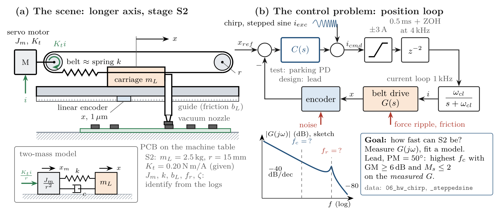

# Homework, Lab 06: how fast can stage S2 be? (100 points)

Stage S2 is a longer belt-driven axis with a heavier carriage (2.5 kg) than the demo stage S1. The
integrator has two identification logs (simulated, labelled as such in their `.json` files), both
recorded at 4 kHz inside a slow parking PD loop, with the excitation current added to the controller
output:

| file | test |
|---|---|
| `data/06_hw_chirp` | logarithmic swept sine, 0.5 A, 1-400 Hz in 12 s |
| `data/06_hw_steppedsine` | stepped sine; `segment`, `f_exc_Hz`, and `measure = 1` on the analysis window |

Columns: `time_s, i_exc_A, i_cmd_A, x_mm`. Motor torque constant Kt and pulley radius r are in the
`.json` (`parameters`); the drive delay is 2 samples, plus half a sample for the zero-order hold.
Use `hw_starter.py`. Report numbers with units; say how you obtained each.

## 1. Frequency response from the chirp (10 pts) — L20
(a) Why can the stage not be tested open loop, and why should the ETFE use the excitation as the
reference, G = H(exc -> x)/H(exc -> i_cmd), rather than S_ux/S_uu? Compare the two at 2 Hz.
(b) Compute the ETFE and the coherence with `ident.etfe` (state `nperseg` and the frequency resolution).
Over which band do you trust it, and why does the coherence fall at high frequency?

## 2. Stepped sine (10 pts) — L20
Use `ident.sine_response` on each analysis window. Tabulate gain and phase at 5, 17, 37.5 and 70 Hz
next to the ETFE values. Why must the window hold an integer number of periods, and why is the settling
time longer near the resonance?

## 3. Read the Bode plot (15 pts) — L21
(a) Fit the rigid-body line |G| = K/w^2 below the resonance (choose and justify the band); give K and
the total inertia J = Kt r/K. (b) Read the resonance frequency f_r and the peak height Q above the
rigid-body line; estimate zeta = 1/(2Q). (c) What slope do you expect above f_r and why?

## 4. Fit a transfer function (15 pts) — L21, L22
(a) Fit `ident.fit_tf(w, G, 0, 4, delay=...)` on the trusted band; list the poles. (b) Fit again with the
integrator built in (fit s G with nb = 0, na = 3, then divide by s); give a, f_r, zeta, K. (c) Judge the
fit: plot the magnitude and phase errors vs frequency, explain any systematic pattern, and say which
fit you would design with.

## 5. Dominant-pole model (10 pts) — L22
Reduce your model to G_lf = K/(s(s + a)). Up to which frequency is it within 1 dB of the full model?
Express it as a fraction of f_r and explain the number from the resonance factor.

## 6. Lead design, checked on the measured response (20 pts) — L21, L24, L26
Design a lead C(s) = K (s/z + 1)/(s/p + 1) on G_lf with the delay for a phase margin of 50 deg. Find the
highest crossover for which the loop C x (MEASURED G) has a gain margin of at least 6 dB and a
sensitivity peak Ms = max|1/(1 + L)| of at most 2. Give z, p, K, the measured crossover, PM, GM (where?)
and Ms, and draw the measured Nyquist plot. Confirm stability with an encirclement argument (P = 0).

## 7. Push the crossover (10 pts) — L26
Raise the design crossover by 50 %. Report the measured margins and Ms, then simulate a 1 mm step with
`ctrlprac.sim.simulate_loop` and `ctrlprac.sim.LTIController` on your structured model of Problem 4(b),
including its resonance (`ct.ss(...)`; current limit, encoder quantization, `delay=(2 - 1) * Ts`). The
simulator applies one sample of delay by itself, so this gives the 2 samples of the drive; the force ripple
may be left out, as in demo 3. Compare both designs (overshoot, residual oscillation).

## 8. Engineering judgement (10 pts)
The customer asks for twice the bandwidth of your Problem 6 design on S2. What limits it, why is the
phase margin at the first crossover not enough to judge, and what would you change (controller,
mechanics, or sensing)? Name one risk of your proposal. Three to five sentences.

**Deliverables:** one PDF with plots (labelled axes with units, legends), numbers and answers; your script.
