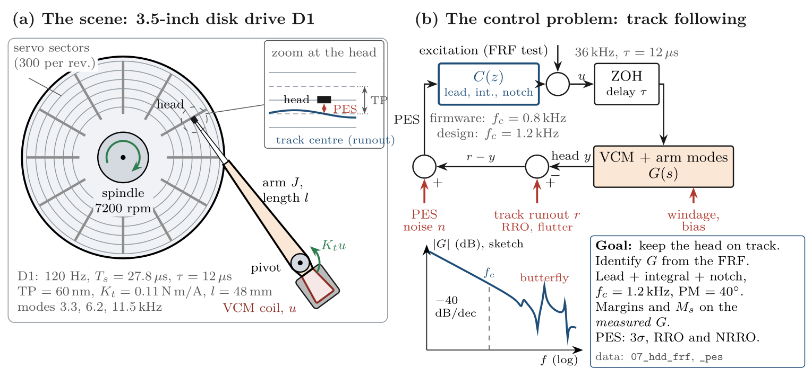

# Lab 07: hard disk drive track following

A voice-coil motor swings the actuator arm of a hard disk drive so that the head follows a data track
60 nm wide. At low frequency the arm is a rigid inertia, but the pivot bearing, the arm and the suspension
add lightly damped resonances at a few kHz, and the servo samples the head position only once per servo
sector. We identify the actuator from a measured frequency response, design a lead and integral
controller with a notch filter for the butterfly mode, check it on the measured response, and use the
sensitivity function to explain and predict the position error signal (PES) with its repeatable and
non-repeatable runout.



## System and parameters

VCM current u -> torque Kt u on the actuator inertia J -> head motion l_arm theta at the end of the arm,
measured in tracks of pitch TP. With the resonances as a modal sum,

    G(s) = Kp [ 1/s^2 + sum_i r_i / (s^2 + 2 zeta_i w_i s + w_i^2) ],   Kp = Kt l_arm / (J TP)  (tracks/(A s^2))

A mode with r_i > 0 is in phase with the rigid body (antiresonance below the resonance), one with r_i < 0
out of phase (antiresonance above). The servo reads the PES from the servo bursts once per sector,
Ts = 60/(rpm x sectors); the current computed from PES(k) reaches the coil tau later and is held until the
next sector (zero-order hold), so at low frequency the loop sees a delay Td = Ts/2 + tau.

| | drive D1 (demos) | drive D2 (homework) |
|---|---|---|
| spindle speed, servo sectors | 7200 rpm (120 Hz), 300 per revolution | 5400 rpm (90 Hz), 360 per revolution (given) |
| sample rate, Ts | 36.0 kHz, 27.8 us | 32.4 kHz, 30.9 us (given) |
| computation delay tau | 12 us (Td = 25.9 us) | identify from the phase |
| track pitch TP | 60 nm (about 420 k tracks per inch) | 75 nm (given) |
| VCM torque constant Kt, pivot-to-head l_arm | 0.11 N m/A, 48 mm | 0.09 N m/A, 50 mm (given) |
| actuator inertia J | 1.9e-5 kg m^2 (Kp = 4.63e9 tracks/(A s^2), 28 g/A) | identify (through Kp) |
| pivot-bearing mode f, zeta, r | 3.3 kHz, 0.05, +0.08 | identify |
| butterfly mode | 6.2 kHz, 0.015, +0.60 | identify |
| suspension sway mode | 11.5 kHz, 0.010, -0.25 | identify |
| firmware controller C0 | lead + integral + notch, crossover 0.8 kHz | lead + integral + notch, crossover 0.65 kHz (given) |

Representative values for a 3.5-inch, 7200 rpm class drive and a slower 5400 rpm drive, not a specific
product. Disturbances of D1 (in the demo sidecars): track runout at the spindle harmonics (1.2 tracks at
1x after the drive's runout feedforward, falling to a few percent of a track at 5x, plus written-in runout
of 0.3 % TP per harmonic up to 60x), disk flutter at 0.9 and 1.5 kHz, windage torque on the arm
(0.15 mA rms equivalent), 1.2 % TP rms PES noise with 1/256 track resolution, and a 12 mA flex-cable bias.
The logs are simulated with `_model.py` and marked `"source": "simulated"`; the demo sidecars give the true
model, the homework sidecars only the test conditions and the given values above.

## Data

| file | content |
|---|---|
| `07_hdd_frf` | D1, swept-sine frequency response VCM current -> head position, 400 points 100 Hz-17 kHz, analyzer export with coherence |
| `07_hdd_pes` | D1, PES during track following with the firmware controller, 50 revolutions (15000 sectors) |
| `07_hw_frf` | D2, swept-sine frequency response, 400 points 100 Hz-15.5 kHz |
| `07_hw_pes` | D2, PES with its firmware controller, 50 revolutions |

Columns: frequency response `f_Hz, mag_dB` (dB re 1 track/A), `phase_deg` (wrapped to +/-180 deg),
`coherence`; PES log `time_s, rev, sector, pes_pct` (% of track pitch), `u_mA` (VCM current command).

## Tool map

| step | course tool | lecture |
|---|---|---|
| swept-sine frequency response, coherence, delay from the phase slope | sinusoidal response, Bode plot | L20 |
| rigid-body -40 dB/dec line, resonance peaks, half-power zeta, antiresonance and r | Bode plot reading, resonance | L21 |
| least-squares fit of the modal model | model approximation from data | L21, L22 |
| lead for crossover and PM with the delay, integral term for the bias | lead and lag design, steady-state error | L12, L18, L21 |
| loop without a notch: extra crossovers at the butterfly mode, Nyquist encirclement | Bode and Nyquist criterion | L21, L24 |
| notch filter, margins on the MEASURED response, delay margin, Ms, python-control check | gain, phase and delay margins, sensitivity | L24, L26 |
| RRO and NRRO, runout through S, waterbed (Bode sensitivity integral) | sensitivity function | L26 |
| PES predicted for a new controller, peak filter at the spindle frequency | sensitivity, loop shaping | L26 |

## Scripts

- `demo_hdd_1_frf.py`: measured response and coherence, delay from the phase slope, Kp and J, resonances
  from the peaks and antiresonances, least-squares modal fit.
- `demo_hdd_2_notch.py`: lead + integral at 1.2 kHz / 40 deg; unstable without a notch (Bode, Nyquist);
  notch at the butterfly mode; margins on the measured response, checked with python-control; |S|, |T|;
  robustness to a shift of the butterfly frequency.
- `demo_hdd_3_pes.py`: PES log, RRO and NRRO, runout through |S0|, NRRO spectrum, waterbed, predicted PES
  with the new controller and with a peak filter at 120 Hz, cumulative 3 sigma.
- `homework.md`, `hw_starter.py`: drive D2.
- `_model.py` (plant, sampled model with delay, controller blocks, margins, modal fit, PES simulation and
  analysis), `_make_data.py` (regenerates the demo logs).

Key results for D1: Td = 26.0 us from the phase slope (true 25.9), Kp within 0.1 %, modal fit within 3 % of
every true parameter. The 1.2 kHz lead + integral design is unstable without a notch; with a 20 dB notch at
6.2 kHz the measured loop has PM 40 deg at 1.17 kHz, GM 12.4 dB, Ms 1.72 and a delay margin of 95 us.
The firmware loop gives a PES 3 sigma of 24.1 % TP (RRO 20.9 %, NRRO 12.1 %); the new controller is
predicted to give 13.2 %, and 11.5 % with a peak filter at the spindle frequency.

## How to run

**Get the materials once.** Clone the repository or download it as a zip file (see
[Get the materials](../../README.md#get-the-materials)), and put the folder on a local disk, not inside Google
Drive, OneDrive or iCloud. Every command below is typed in a terminal (macOS: Terminal; Windows: PowerShell)
inside that folder. It is called `control-in-practice` after `git clone` and `control-in-practice-main` after
unzipping; `cd control-in-practice*` works for both.

**Option 1: JupyterLab in Docker (recommended).** Install [Docker Desktop](https://www.docker.com/products/docker-desktop/)
and start it, then run

```bash
cd control-in-practice*
docker compose up --build         # the first time builds the image (a few minutes); afterwards: docker compose up
```

When the terminal shows a line with `http://127.0.0.1:8888/lab`, open http://localhost:8888 in your browser. In
the file browser on the left, open `notebooks/07_hdd/` and double-click a notebook. Run its cells in order with
Shift+Enter; the figures appear under the cells. The notebooks of this lab are

| notebook | content |
|---|---|
| `demo_hdd_1_frf.ipynb` | identifying the VCM actuator from a measured frequency response |
| `demo_hdd_2_notch.ipynb` | lead and integral design, a notch for the butterfly mode, margins on the measured response |
| `demo_hdd_3_pes.ipynb` | the position error signal, runout, and what the sensitivity function does to it |
| `hw_starter.ipynb` | starter for the homework |

Your changes are saved in the folder on your disk. To stop, press Ctrl+C in the terminal and then run
`docker compose down`. To run all demos and the homework starter of this lab without the browser, use

```bash
docker compose run --rm lab python run_all.py 07_
```

The printed numbers appear in the terminal and the figures are saved in `out/` as `07_hdd_<script>_<n>.png`.

**Option 2: Python on your own computer.** You need Python 3.11 or newer. Set up an environment once:

```bash
cd control-in-practice*
python -m venv .venv
source .venv/bin/activate         # Windows PowerShell: .venv\Scripts\Activate.ps1
python -m pip install -r requirements.txt
```

In every new terminal, activate the environment again and tell Python where `ctrlprac` is:

```bash
cd control-in-practice*
source .venv/bin/activate         # Windows PowerShell: .venv\Scripts\Activate.ps1
export PYTHONPATH=$PWD            # Windows PowerShell: $env:PYTHONPATH = $PWD
python labs/07_hdd/demo_hdd_1_frf.py         # one demo; each figure opens in a window, close it to continue
python run_all.py 07_               # all demos and hw_starter.py of this lab, figures saved in out/
jupyter lab                       # the same notebooks as in Option 1, in your browser
```

**Homework.** Write your solution in `labs/07_hdd/hw_starter.py` (run it with `python labs/07_hdd/hw_starter.py`)
or in `notebooks/07_hdd/hw_starter.ipynb`, and submit the file you worked in. The two start out identical but are
separate files, so pick one and stay with it.
