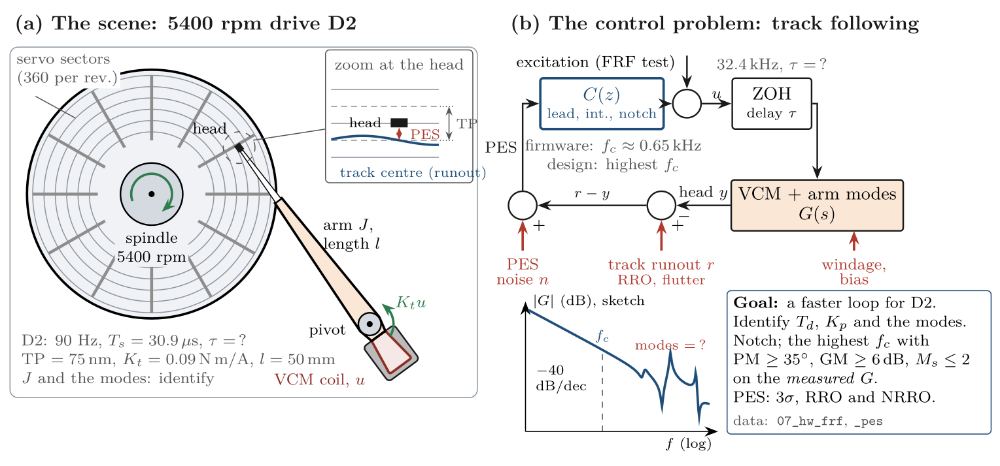

# Homework, Lab 07: a faster track-following loop for drive D2 (100 points)

Drive D2 is a 5400 rpm, 3.5-inch class drive with 360 servo sectors per revolution (32.4 kHz) and a 75 nm
track pitch; the drive in the demos is D1. Its firmware controller has a crossover near 650 Hz, and the PES
budget calls for less runout. You have two logs (simulated, labelled as such in their `.json` files), both
recorded with the firmware controller in the loop:

| file | test |
|---|---|
| `data/07_hw_frf` | swept-sine frequency response from VCM current to head position, 400 points from 100 Hz to 15.5 kHz, exported by the servo analyzer: `f_Hz, mag_dB` (dB re 1 track/A), `phase_deg` (wrapped to +/-180 deg), `coherence` |
| `data/07_hw_pes` | PES during track following, 50 revolutions: `time_s, rev, sector, pes_pct` (% of track pitch), `u_mA` (VCM current command) |

The `.json` files give the sample time, the track pitch, the VCM torque constant Kt, the pivot-to-head length
l_arm and the firmware controller (`M.controller(Ts, K, fz, fp, fi, notch)` rebuilds it). The computation
delay and the resonances are not given. Use `hw_starter.py`. Report numbers with units and say how you
obtained each. Unless a problem says otherwise, design with PM = 40 deg and an integral corner fi = fc/10.

## 1. Frequency response and coherence (10 pts) — L20
(a) Plot the magnitude, the unwrapped phase and the coherence. Over which band do you trust the
measurement? (b) Explain each region where the coherence falls below 0.9 from what the loop and the
disturbances do there. (c) Why must the analyzer use the excitation, and not the current command, as the
reference when the loop is closed?

## 2. Delay and rigid-body gain (10 pts) — L20, L21
(a) Estimate the total delay Td from the phase slope below 1.5 kHz and explain why the line should pass
through -180 deg at f = 0. Split Td into the zero-order hold and the computation delay tau. (b) Estimate
Kp from the -40 dB/dec line and the actuator inertia J = Kt l_arm/(Kp TP). (c) How many degrees does the
delay cost at 1 kHz and at the largest resonance?

## 3. Resonances and the modal fit (15 pts) — L21
(a) Divide the measurement by the rigid-body line and find every resonance between 2 and 12 kHz. For each,
estimate f_i, zeta_i from the half-power width and r_i from the antiresonance; say which modes are in phase
with the rigid body. (b) Refine all parameters with `M.fit_modal` and tabulate both sets of numbers.
(c) Plot the fit over the data and give the rms error. Where does the fit miss, and does it matter for a
crossover near 1 kHz?

## 4. Lead and integral without a notch (10 pts) — L18, L21, L24
Design C(s) = K (s/z + 1)/(s/p + 1) (s + w_i)/s on the rigid-body model with its delay for fc = 1 kHz.
(a) Give z, p, K and the lead phase. (b) Plot L = C G on the measured response (Bode) and the Nyquist plot
near -1, and check the closed-loop poles on your fitted model. (c) Explain in two or three sentences
what the rigid-body design missed.

## 5. Notch filter and the highest crossover (20 pts) — L21, L24, L26
(a) Add a notch at the butterfly mode; justify its depth and width. Compare it with the firmware notch.
(b) Find the highest crossover, in steps of 50 Hz, for which the measured loop has PM >= 35 deg, GM >= 6 dB
and Ms <= 2, and the closed loop on your fitted model is stable. Noise near the disk-flutter frequencies can
make |L| cross 0 dB several times within a few percent of fc; treat such a cluster as one crossover and
report its smallest PM. Give z, p, K, the measured crossover, PM, GM (where?), Ms and the delay margin in
microseconds and in samples. (c) Check PM, GM and Ms with
`ct.stability_margins(ct.frd(L, w))`. (d) Which part of the plant sets the limit you found? (e) Move the
butterfly mode of your fitted model by -5 % and +5 % and report the margins of your design.

## 6. The PES with the firmware controller (15 pts) — L20, L26
(a) Split the PES into RRO and NRRO by averaging over revolutions; give 3 sigma of each in % TP and in nm.
(b) Give the amplitudes of the first five spindle harmonics in the PES, and estimate the track runout at
each by dividing by |S0| of the firmware loop. Above which harmonic does the loop amplify the runout?
(c) Plot the NRRO spectrum and NRRO PSD/|S0|^2, and name the frequencies of the disk flutter.

## 7. Predicted PES with your controller and a peak filter (10 pts) — L26
(a) Predict the PES with your Problem 5 controller with `M.predict_pes` and give 3 sigma, RRO and NRRO.
(b) Add a peak filter at the spindle frequency (+20 dB, zeta_z = 0.1) and repeat; give the new margins on the
measured response. (c) Compute the integral of ln|S| over 0 to fs/2 for the firmware loop and for yours, and
use it to explain where your controller pays for the lower PES.

## 8. Engineering judgement (10 pts)
The product team wants another 20 % off the PES 3 sigma of your Problem 7 design. Using your results, say
which component of the PES you would attack next and with what change (controller, servo pattern, or
mechanics), what limits the crossover now, and one risk of your proposal. Four to six sentences.

**Deliverables:** one PDF with plots (labelled axes with units, legends), numbers and answers; your script.
